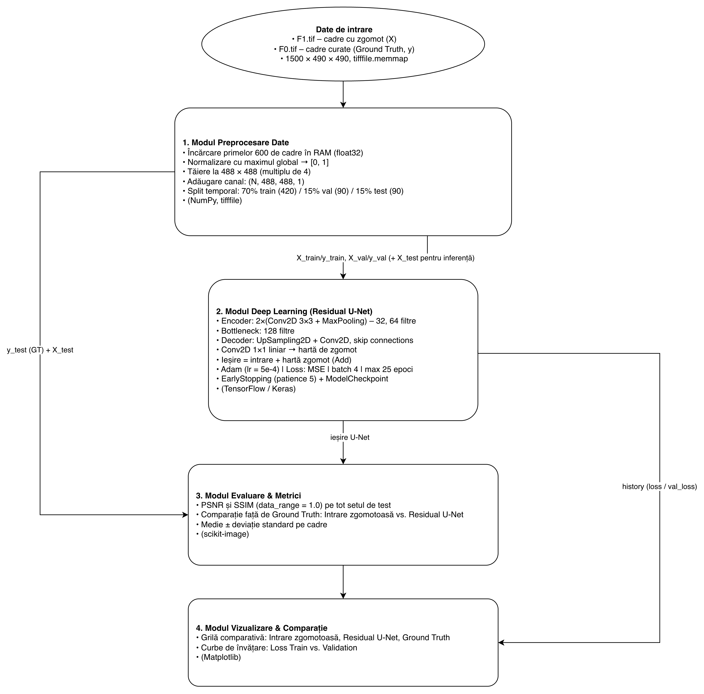

# Reducerea zgomotului în imagistica cu calciu (Calcium Imaging Denoising)

## 1. Descriere Generală
Proiectul își propune reducerea zgomotului din secvențe video de imagistică cu calciu folosind o rețea neuronală convoluțională de tip **Residual U-Net**.

Se folosesc două înregistrări în format TIFF, de câte 1500 de cadre de 490 × 490 pixeli: `F1.tif` (cadre cu zgomot, intrarea rețelei) și `F0.tif` (cadre curate, Ground Truth). Din motive de memorie RAM se folosesc primele 600 de cadre.

Calitatea reconstrucției este măsurată cu PSNR și SSIM față de Ground Truth, pe un set de test separat de cel de antrenare.

### Rulare
Notebook-ul `Calcium_denoising.ipynb` este făcut pentru Google Colab (GPU recomandat, ex. T4). Prima celulă descarcă automat `F0.tif` și `F1.tif` cu `gdown`; apoi se rulează celulele în ordine.

---

## 2. Analiza Literaturii de Specialitate (State-of-the-Art)
# Calcium Imaging Denoising Methods (2020–2025)

| Autor(i) / An | Titlul articolului / proiectului | Domeniul de aplicare | Tehnologie / Algoritm | Metodologie / Abordare | Rezultate / Performanță | Limitări | Comentarii suplimentare |
| :--- | :--- | :--- | :--- | :--- | :--- | :--- | :--- |
| **Li et al. (2021)** *(DeepCAD)* | *Reinforcing neural spike detection in deep-tissue calcium imaging with 3D self-supervised denoising* | Imagistică de calciu în țesuturi profunde (neuroștiințe, microscopie optică). | Rețele Convoluționale 3D (CNN), Deep Learning Self-Supervised, Python, PyTorch, GPU-uri performante | Antrenarea unei rețele fără imagini "ground truth" curate, folosind cadre temporale 3D adiacente pentru eliminarea zgomotului Poisson. | Creșterea SNR-ului de >10 ori, reducerea laserului cu până la 90%, detectarea spike-urilor cu o acuratețe de >95%. | Poate introduce mici artefacte vizuale la mișcări elastice extreme ; necesită GPU-uri puternice. | Open-source. Permite imagistică la puteri laser foarte mici. **Sugestie:** De integrat arhitectura 3D dacă experimentăm cu date volumetrice. |
| **Lecoq et al. (2021)** *(DeepInterpolation)* | *Removing independent noise in biological microscopy with DeepInterpolation* | Microscopie biologică și înregistrări de activitate neuronală. | Deep Learning (U-Net adaptat spațio-temporal), Python (PyTorch/TensorFlow), stații cu GPU. | Prezice cadrul pe baza cadrelor adiacente din trecut și viitor, eliminând zgomotul independent temporal. | Creșterea SNR-ului de >6 ori pe date cu zgomot Poisson și de citire CMOS. | Poate subestima zgomotul corelat temporal pe perioade lungi; procesare mai lentă per cadru. | Funcționează excelent pe serii temporale 2D de mari dimensiuni. **Sugestie:** Poate fi folosit ca baseline/benchmark rapid pentru validarea calității imaginii. |
| **Giovannucci et al. (2020/2022)** *(CaImAn / CNMF-E)* | *CaImAn an open source pipeline for calcium imaging data analysis* | Extragerea automată a urmelor de calciu și a semnalelor neuronale din date brute. | Descompunere Matriceală Non-Negativă (CNMF-E) + CNN, ecosistem MATLAB/Python, NumPy, SciPy, CPU multi-core.| Descompune matricea de date brute în componente celulare (spațiale) și semnale de calciu (temporale). | Standardul industrial pentru izolarea semnalului de fundal; acuratețe de >90% în extragerea urmelor de calciu fără neuropil. | Sensibil la variații mari de iluminare de fond; necesită ajustarea manuală a parametrilor inițiali. | Soluție clasică/hibridă. Transparență matematică totală. **Sugestie:** De utilizat post-denoising pentru extracția finală a metodelor spike. |
| **Buchanan et al. (2022)** *(DeepVID)* | *Deep Learning for Real-Time Video Denoising in Optical Imaging* | Imagistică optică și electrofiziologie optică în timp real. | Autoencodere Convoluționale Temporale, Python, cadre de deep learning optimizate, GPU-uri pentru inferență rapidă. | Antrenament self-supervised pe secvențe video rapide pentru reducerea zgomotului la nivel de pixel în timp real. | Denoising la frecvențe de >100 Hz cu latență de procesare sub 10 ms per cadru. | Compromis la calitatea spațială comparativ cu modelele 3D mai mari care procesează offline. | Optim pentru experimente în timp real unde latența scăzută este critică. **Sugestie:** De analizat compromisul viteză-calitate. |
| **Guan et al. (2024)** *(ST-Transformer)* | *Spatio-Temporal Transformer for Ultra-Low Light Calcium Imaging Denoising* | Imagistică de calciu la lumină ultra-slabă | Vision Transformers (ViT) Spațio-Temporali, Python, PyTorch, Cluster/GPU cu VRAM mare | Utilizează mecanisme de atenție (Self-Attention) pentru a corela informația din pixeli îndepărtați spațial și temporal. | Reconstrucție precisă a semnalului de calciu la nivel de foton unic (ultra-low light imaging). | Risc de over-smoothing dacă atenția nu este calibrată; cerințe extreme de memorie VRAM. | Surprinde dependențe pe distanțe lungi mult mai bine decât CNN-urile. **Sugestie:** Abordare de vârf pentru date extrem de zgomotoase. |

---

## 3. Arhitectura Soluției

### Schema Bloc

### Descrierea Arhitecturii Soluției

- **Date de Intrare (Data Ingestion):** Secvențele `F1.tif` (cu zgomot) și `F0.tif` (Ground Truth) sunt deschise cu `tifffile.memmap` (încărcare la cerere, fără a umple RAM-ul). Se verifică faptul că cele două fișiere au aceeași formă (1500 × 490 × 490).

- **Modulul de Preprocesare Date:** Primele 600 de cadre sunt încărcate în RAM ca `float32`. Valorile se normalizează în `[0, 1]` împărțind ambele secvențe la maximul global **calculat exclusiv pe subsetul de antrenament (primele 70% din cadre)**, prevenind astfel scurgerea de informații (*Data Leakage*). Cadrele sunt tăiate la 488 × 488 (multiplu de 4, necesar pentru cele două operații de pooling din U-Net) și se adaugă dimensiunea de canal. Împărțirea este **temporală**: primele 70% din cadre pentru antrenare (420), următoarele 15% pentru validare (90) și ultimele 15% pentru test (90).

- **Modulul Deep Learning (Residual U-Net):** Rețea implementată în `TensorFlow/Keras`, cu doi pași de reducere (*Encoder*: 32 și 64 de filtre), un *Bottleneck* de 128 de filtre și doi pași de reconstrucție (*Decoder*, `UpSampling2D` + `Conv2D`) cu conexiuni directe (*Skip Connections*). Ultimul strat (`Conv2D` 1×1, activare liniară) estimează o **hartă de zgomot**, care este adunată la imaginea de intrare (`Add`), deci rețeaua învață reziduul, nu imaginea completă. Antrenare: optimizator Adam (learning rate 5·10⁻⁴), funcție de cost MSE, batch de 4 cadre, maximum 25 de epoci, cu `EarlyStopping` (patience 5, restaurarea celor mai bune ponderi) și `ModelCheckpoint` pe `val_loss`.

- **Modulul de Evaluare & Metrici:** Calculează **PSNR** și **SSIM** (`scikit-image`, `data_range=1.0`) pentru cadrele din setul de test raportate la Ground Truth, comparând intrarea zgomotoasă cu ieșirea rețelei Residual U-Net.

- **Modulul de Vizualizare:** Afișează o grilă comparativă (Intrare zgomotoasă, Residual U-Net, Ground Truth) pentru un cadru din setul de test și oferă o reprezentare vizuală clară a eliminării zgomotului de fundal.

---

## 4. Rezultate

| Metodă | PSNR (dB) | SSIM |
| :--- | :--- | :--- |
| Intrare zgomotoasă | 45.54 | 0.969 |
| Residual U-Net | 56.03 | 0.997 |
| Ground Truth (Referință) | ∞ (Inf) | 1.000 |
