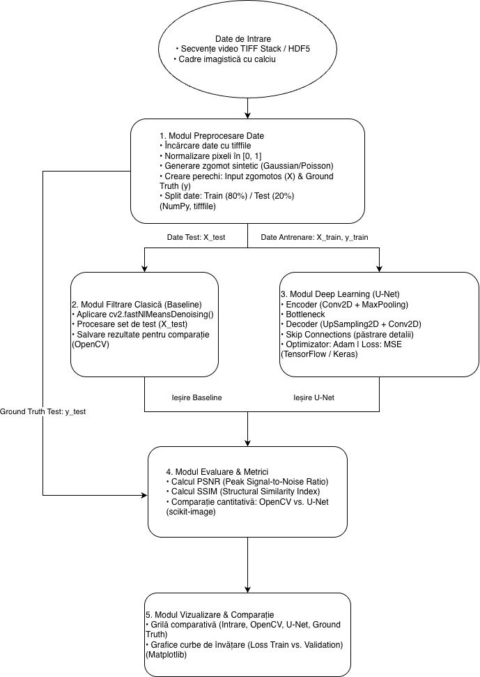

# Reducerea zgomotului în imagistica cu calciu (Calcium Imaging Denoising)

## 1. Descriere Generală
Proiectul își propune eliminarea zgomotului (Poisson și Gaussian) din secvențe video de imagistică cu calciu folosind o abordare bazată pe rețele neuronale convoluționale (arhitectura U-Net) și compararea acesteia cu o metodă clasică de filtrare (OpenCV Fast Non-Local Means).

---

## 2. Analiza Literaturii de Specialitate (State-of-the-Art)

## 3. Arhitectura Soluției

### Schema Bloc

### Descrierea Arhitecturii Soluției

- **Date de Intrare (Data Ingestion):** Recepționează secvențele video de imagistică cu calciu în format `.tif` sau `HDF5` și le încarcă în memorie sub formă de matrici 3D cu ajutorul bibliotecii `tifffile`.

- **Modulul de Preprocesare Date:** Realizează normalizarea valorilor pixelilor în intervalul `[0, 1]`. Generează zgomot sintetic (Gaussian/Poisson via `NumPy`) adăugat peste imaginile originale pentru a crea perechile de antrenare: imagini cu zgomot (`X`) și ținta curată / Ground Truth (`y`). Împarte setul de date în 80% antrenare și 20% testare.

- **Modulul de Filtrare Clasică (OpenCV Baseline):** Aplică algoritmul clasic `cv2.fastNlMeansDenoising()` pe setul de test pentru a stabili o linie de referință (baseline).

- **Modulul Deep Learning (Rețeaua U-Net):** Implementează o rețea neuronală convoluțională bazată pe arhitectura U-Net în `TensorFlow/Keras`. Conține o etapă de reducere a dimensiunii (*Encoder*), o etapă de reconstrucție (*Decoder*) și conexiuni directe (*Skip Connections*) pentru a conserva detaliile morfologice fine ale neuronilor.

- **Modulul de Evaluare & Metrici:** Calculează metrici matematice obiective de calitate a imaginii — **PSNR** și **SSIM** — folosind pachetul `scikit-image`, comparând rezultatele oferite de metoda clasică și metoda Deep Learning raportat la Ground Truth.

- **Modulul de Vizualizare:** Afișează o grilă comparativă a imaginilor procesate și randează graficele cu curbele de învățare (*Loss Train vs. Validation*) folosind `Matplotlib`.
